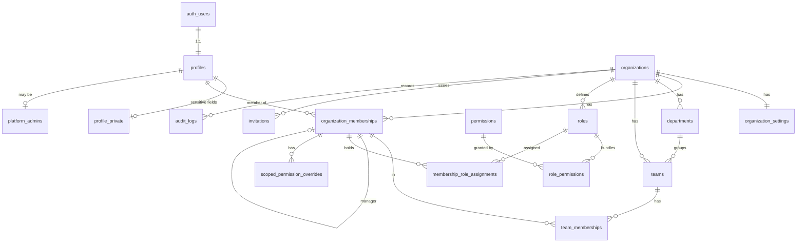

# Wave Team Pro — Architecture Overview

Status: Phase A (foundation). Last updated 2026-10-20.

## 1. Repository audit

The project was scaffolded fresh with `create-next-app@16`.

## 2. Assumptions

| # | Assumption | Consequence |
|---|---|---|
| A1 | The platform is invite-only. No public sign-up. | `enable_signup = false` in Supabase Auth; accounts are created through `auth.admin.inviteUserByEmail`. |
| A2 | An organization = one legal entity. A user can be a member of several. | All tenant data carries `organization_id`; permissions are evaluated per organization. |
| A3 | The active organization is part of the URL (`/o/[org]/…`). | Deep links and multiple tabs on different entities work; no hidden "current org" state. |
| A4 | Platform owners provision organizations and nothing else. | `platform_admins` grants `create_organization` only — no read access to tenant data. |
| A5 | English is the only shipped UI language in V1; Romanian file exists as a scaffold. | `src/i18n/messages/{en,ro}.json`. |
| A6 | Avatars are visible to everyone who shares an active organization with the person. | Enforced by the `avatars` storage bucket policy and short-lived signed URLs. |
| A7 | HEIC images are not decodable by the prebuilt `sharp` binary. | Mobile browsers convert camera captures to JPEG; HEIC uploads are rejected with a clear message. |

## 3. Runtime architecture

```
Browser (PWA, mobile-first)
   │  HTTPS, HttpOnly Supabase session cookies
   ▼
Next.js 16 App Router (Node runtime, Vercel)
   ├─ proxy.ts ............ refreshes session cookies, redirects anonymous users
   ├─ Server Components ... read data with the *user's* Supabase client (RLS applies)
   ├─ Server Actions ...... validate with Zod → re-check permission → mutate with user client
   └─ Admin service ....... service-role client, server-only, used for: auth admin API
                            (invite/ban), avatar object writes after image re-encoding
   ▼
Supabase
   ├─ Auth (GoTrue) ....... invite, email confirm, password reset, TOTP MFA
   ├─ Postgres ............ RLS on every table, default deny, SECURITY DEFINER helpers
   ├─ Storage ............. private buckets, object policies mirror table RLS
   └─ Realtime ............ (Phase B) chat, presence, notifications
```

Defence in depth: every server action checks permission in TypeScript **and** the
database re-checks it through RLS. The UI hides what a user can't do, but hiding is never
the control.

## 4. Permission model

* `permissions` — global catalog of capability keys (e.g. `users.invite`) and the scopes
  each supports (`organization`, `team`, `project`, `self`).
* `roles` — per-organization bundles; seeded from templates when an organization is
  created, fully editable except the protected `super_admin` template.
* `membership_role_assignments` — role granted to a membership at a scope
  (organization-wide, or one team / project).
* `scoped_permission_overrides` — individual grant/deny with optional expiry and reason.
  **Deny wins.**
* `public.has_permission(org, key, scope_type, scope_id)` — the single evaluation function
  used by RLS and by the app (`rpc('has_permission')`). Returns false if the caller's
  profile or membership is not active, or if the org requires MFA for sensitive
  permissions and the session is not `aal2`.

Escalation guards (database triggers, so they hold even for direct API calls):

1. You cannot assign a role, create a grant override, or add a permission to a role
   unless you hold every permission involved at that scope yourself.
2. You cannot change your own role assignments or overrides.
3. An organization can never lose its last active super admin.
4. Platform owners have no implicit tenant access; private messages (Phase B) will be
   readable only by conversation members.

## 5. Phase A entity–relationship diagram



Cross-tenant integrity: child tables reference parents with composite foreign keys
`(id, organization_id)`, so a team in organization A cannot be attached to a membership in
organization B even by a buggy server action.

## 6. Phase plan

| Phase | Scope | Status |
|---|---|---|
| A | Auth, invitations, orgs/memberships, roles & permissions, RLS, directory, profiles & avatars, shell, tests | **This delivery** |
| B | Chat (DM/group/channel), attachments, announcements, notifications, document center | Next |
| C | Projects, tasks, shifts, attendance, timesheets, leave | — |
| D | Receipt intake, AI extraction, expense approval, reimbursements, XLSX/ZIP exports | — |
| E | Hardening, observability, localization, runbooks, production checklist | — |

See `docs/architecture/adr/` for decisions and `docs/security/` for the threat model.
